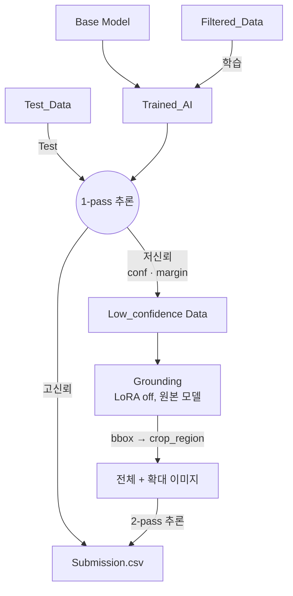
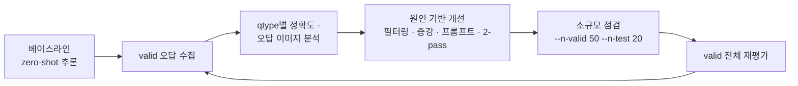

<div align="center">

# 🏯 흥선대원군의 AI 척화비

**AI Challenge · Team A185** · 2026.09.23 발표


이미지 + 질문 + 4지선다(a~d)로 구성된 **이미지 기반 객관식 질의응답(VQA)** 과제에 대해<br/>
데이터 정제 → 회전 증강 → LoRA 학습 → 로짓 스코어링 추론 → 저신뢰 샘플 Crop 2-pass 재추론으로 이어지는 파이프라인을 구축했습니다.

</div>

---

## 📑 목차

- [팀원 소개](#-팀원-소개)
- [개발 환경](#-개발-환경)
- [Ⅰ. 솔루션 코드 설명](#-ⅰ-솔루션-코드-설명)
- [Ⅱ. 실행 방법](#-ⅱ-실행-방법)
- [Ⅲ. 접근 전략](#-ⅲ-접근-전략)
- [Ⅳ. 실험 설계](#-ⅳ-실험-설계)
- [요약](#-요약)

---

## 👥 팀원 소개

|  |  |  |  |
| :---: | :---: | :---: | :---: |
| **김대원** | **민수영** | **강민준** | **박서영** |
| 팀장 | 팀원 | 팀원 | 팀원 |
| AI 성능 최적화, EDA | AI 구조 파이프라인 설계 | 데이터 전처리 및 증강, EDA | AI 성능 향상, 데이터 EDA |

---

## 🛠 개발 환경

| 항목 | 내용 |
| --- | --- |
| Base Model | **Qwen3.5-4B** (`Qwen/Qwen3.5-4B`, 프리셋 `qwen3.5-4b`, bf16) |
| 파인튜닝 기법 | **LoRA** (PEFT, 언어 모델 부분에만 적용) |
| 학습·추론 환경 | Google **Colab** (GPU 런타임) / 로컬 **NVIDIA GeForce RTX 5060 Ti** |
| 주요 라이브러리 | `transformers>=5.16`, `peft`, `accelerate`, `flash-linear-attention`, `huggingface_hub`, `pillow`, `pandas`, `numpy`, `tqdm` |
| 선택 라이브러리 | `bitsandbytes` (4bit 프리셋 사용 시), `modelscope` (HF 다운로드가 막힐 때) |
| 데이터 분석 보조 | Claude (해석이 어려운 문항 탐지) |

<details>
<summary><b>지원 모델 프리셋 (<code>config.MODEL_PRESETS</code>)</b></summary>

| 프리셋 | Hugging Face repo | 정밀도 | grounding 좌표계 |
| --- | --- | :---: | :---: |
| `qwen2.5-vl-3b` | Qwen/Qwen2.5-VL-3B-Instruct | bf16 | abs |
| `qwen2.5-vl-7b` | Qwen/Qwen2.5-VL-7B-Instruct | 4bit | abs |
| `qwen3-vl-8b` | Qwen/Qwen3-VL-8B-Instruct | 4bit | norm1000 |
| **`qwen3.5-4b`** | **Qwen/Qwen3.5-4B** | **bf16** | **norm1000** |
| `qwen3.5-9b` | Qwen/Qwen3.5-9B | 4bit | norm1000 |
| `qwen3.5-9b-bf16` | Qwen/Qwen3.5-9B | bf16 | norm1000 |

4bit 프리셋은 NF4 + double quant를 사용하며, **비전 인코더(`visual`)와 출력층(`lm_head`)은 양자화하지 않습니다.**

</details>

---

## 🧩 Ⅰ. 솔루션 코드 설명

<!-- TODO: 솔루션 코드 설명 작성 예정 (디렉토리 구조, 주요 파일/모듈별 역할 등) -->

> 작성 예정

---

## ▶️ Ⅱ. 실행 방법

### 1. 설치

#### (A) Google Colab

```python
from google.colab import drive; drive.mount('/content/drive')
!unzip -q /content/drive/MyDrive/<코드 zip>.zip -d /content
!unzip -q /content/drive/MyDrive/<데이터 zip>.zip -d /content/data
%cd /content/<코드 폴더>
!pip install -q -r requirements.txt
```

> Colab은 PyTorch(CUDA)가 기본 설치되어 있으므로 `requirements.txt`만 설치하면 됩니다.

#### (B) 로컬 (RTX 5060 Ti)

```bash
python -m venv .venv
source .venv/bin/activate          # Windows: .venv\Scripts\activate

# RTX 50 시리즈(Blackwell, sm_120)는 CUDA 12.8 이상으로 빌드된 PyTorch가 필요합니다.
pip install torch torchvision --index-url https://download.pytorch.org/whl/cu128
pip install -r requirements.txt
```

> 💡 구버전 CUDA(cu121, cu124 등) 빌드의 PyTorch를 설치하면 `no kernel image is available for execution on the device` 오류가 발생할 수 있습니다.

### 2. 데이터 준비

```text
<데이터 폴더>/
├── train.csv  dev.csv  test.csv  sample_submission.csv
├── train/     # 학습 이미지
├── dev/       # dev 이미지
└── test/      # 테스트 이미지
```

- `--data-root <데이터 폴더>` 또는 환경변수 `VQA_DATA_ROOT` 로 경로를 지정합니다.
- 지정하지 않으면 **현재 폴더 → 상위 폴더 → 코드 폴더** 순으로 `train.csv` 가 있는 곳을 자동으로 찾습니다.
- `--data-root` 는 반드시 `train.csv` 가 **직접 들어 있는 폴더**여야 합니다. (zip 안에 폴더가 한 겹 더 있으면 그 폴더)

### 3. 환경변수

| 변수 | 기본값 | 설명 |
| --- | --- | --- |
| `VQA_DATA_ROOT` | 자동 탐색 | 데이터 폴더 |
| `VQA_MODEL_ROOT` | `<코드 폴더>/models` | 모델 가중치 저장 위치 (HF 캐시 `HF_HOME` 도 이 아래에 생성) |
| `VQA_ONLINE` | `1` | `0` 이면 오프라인 모드 (받아 둔 모델만 사용) |
| `VQA_DISABLE_FLA` | – | `1` 이면 flash-linear-attention을 끄고 PyTorch 구현 사용 (속도 비교용) |

> 모델은 첫 실행 시 `models/` 에 자동으로 다운로드됩니다. 중간에 끊겨도 이어받기와 최대 8회 재시도(지수 백오프)를 하며, 계속 실패하면 `--download-source modelscope` 로 바꿀 수 있습니다.

### 4. 추론 실행 (`predict.py`)

처음에는 **몇 분 안에 끝나는 설정으로 끝까지 도는지 먼저 확인**합니다.

```bash
# ① 동작 점검 (valid 50문항, test 20문항) — submission.csv 에는 20문항만 담김
python predict.py --data-root <데이터 폴더> --preset qwen3.5-4b --n-valid 50 --n-test 20

# ② 본 실행: valid 정확도 측정 + test 전체 → submission.csv
python predict.py --data-root <데이터 폴더> --preset qwen3.5-4b --batch-size 8

# ③ 학습한 LoRA 어댑터를 얹어 추론
python predict.py --data-root <데이터 폴더> --preset qwen3.5-4b --adapter <어댑터 폴더> --prompt A

# ④ 선지 순서 TTA (4배 느림)
python predict.py --data-root <데이터 폴더> --preset qwen3.5-4b --tta

# ⑤ 제출 파일만 필요할 때
python predict.py --data-root <데이터 폴더> --preset qwen3.5-4b --splits test
```

> ⚠️ `config.py` 의 기본 프리셋(`DEFAULT_PRESET`)은 `qwen3.5-9b-bf16`(24GB 이상 GPU 필요)이므로, 4B 모델로 실행하려면 **`--preset qwen3.5-4b` 를 반드시 지정**해야 합니다.

#### 주요 인자

| 인자 | 기본값 | 설명 |
| --- | --- | --- |
| `--preset` | `qwen3.5-9b-bf16` | 모델 프리셋 |
| `--adapter` | 없음 | LoRA 어댑터 폴더 (없으면 zero-shot) |
| `--prompt` | `A` | 프롬프트 종류 (`A` / `B`) |
| `--tta` | off | 선지 순서 4가지(abcd·bcda·cdab·dabc)로 추론 후 평균 |
| `--splits` | `valid test` | 실행할 split |
| `--n-valid`, `--n-test` | 전체 | 점검용 일부 추출 (**제출용은 반드시 전체**) |
| `--batch-size` | 32 | 한 번에 forward하는 입력 수 (`--tta` 면 문항당 4개) |
| `--max-side` | 1024 | 이미지 픽셀 수 상한 = side² |
| `--out-dir` | `outputs` | 결과 저장 폴더 |
| `--download-source` | `hf` | `hf` / `modelscope` |

#### GPU별 권장 설정

| GPU | 프리셋 | 배치 |
| --- | --- | --- |
| A100 40GB | `qwen3.5-9b-bf16` | 32 (실측, 최악 입력 기준 31.1GB) |
| L4 24GB | `qwen3.5-9b-bf16` | 8부터 시도 |
| 그 이하 (RTX 5060 Ti 등) | **`qwen3.5-4b`** 또는 `qwen3.5-9b`(4bit) | 8부터 시도 |

### 5. 출력물 (`--out-dir`, 기본 `outputs/`)

| 파일 | 내용 |
| --- | --- |
| `submission.csv` | 제출 파일. `sample_submission.csv` 의 id 순서·개수·형식을 점검한 뒤 저장 |
| `test_pred.csv` | 문항별 `p_a..p_d`, `pred`, `conf`(1위 확률), `margin`(1·2위 차이), `qtype`(질문 유형) |
| `valid_pred.csv` | dev 합의 문항 예측과 `gold`(다수결 정답) |
| `run_info.json` | 실행 설정, valid 정확도, 문항당 소요 시간 |

> 제출 전 `submission.csv` 의 예측 분포가 **한 선지에 50% 이상 쏠리면 경고**가 출력됩니다.

### 6. 학습 · 2-pass 재추론 · 병합

<!-- TODO: 학습 / grounding·크롭 재추론 / 결과 병합 스크립트의 실행 명령을 추가해 주세요. -->

| 단계 | 내용 | 명령어 |
| :---: | --- | --- |
| 학습 | LoRA 학습 (`VLM(..., train_lora=True)` + `choice_loss`) | `<학습 스크립트>` |
| 1-pass | `predict.py` 로 전체 예측 + `conf`/`margin` 저장 | 위 4번 참고 |
| 2-pass | 저신뢰 문항 grounding → 크롭 → [전체+확대] 재추론 | `<재추론 스크립트>` |
| 병합 | 1-pass 고신뢰 + 2-pass 결과 → `submission.csv` | `<병합 스크립트>` |

### 7. 자주 나는 문제

| 증상 | 해결 |
| --- | --- |
| `Found an incompatible version of torchao` (어댑터를 얹을 때) | `pip uninstall -y torchao` 후 재실행 (이 코드는 torchao를 사용하지 않음) |
| `CUDA out of memory` | `--batch-size` 를 낮추거나 더 작은 프리셋 사용. OOM이 난 배치만 1개씩 자동 재시도하며 `⚠ OOM` 이 출력됨 |
| 생각보다 느림 | `pip show flash-linear-attention` 으로 설치 확인. 없으면 Qwen3.5가 느린 PyTorch 구현으로 동작 |
| `이미지 N개를 찾지 못함` | `--data-root` 에 `train/ dev/ test/` 이미지 폴더가 있는지 확인 |
| `thinking 모드가 켜져 있어…` | 채팅 템플릿이 thinking을 강제하는 경우. 다른 프리셋 사용 |

---

## 🎯 Ⅲ. 접근 전략

전체 전략은 **"모델을 키우기보다, 데이터와 입력을 모델이 풀기 쉬운 형태로 만든다"** 는 방향으로 설계했습니다.

| # | 전략 | 해결하려는 문제 | 핵심 방법 |
| :---: | --- | --- | --- |
| 1 | **데이터 품질 우선** | 답이 모호하거나 틀린 샘플이 학습을 오염시킴 | 5인 답변 다수결 + 합의 비율 필터링 + Claude 검수 |
| 2 | **오답 기반 증강** | 회전된 이미지에서 오답이 집중됨 | 좌우 30° 회전 증강 + EXIF 회전 보정 |
| 3 | **질문 유형 분류** | 질문마다 요구하는 추론 방식이 다름 | 정규식 기반 qtype 분류 + 목적별 프롬프트 |
| 4 | **로짓 스코어링 추론** | 생성 방식은 형식 오류·파싱 실패 위험 | a/b/c/d 토큰 확률만 비교 + 선지 순서 TTA |
| 5 | **경량 파인튜닝** | 제한된 GPU(Colab, 5060 Ti) | 4B 모델 + LoRA, 4지 분류 손실 |
| 6 | **불확실한 샘플 재추론** | 작은 글자·세부 정보를 놓침 | grounding bbox로 크롭 → [전체+확대] 2-pass |

### 전략 1. 데이터 품질 우선 — 전처리 · EDA

#### 데이터셋 현황

| 구분 | 정답 형태 |
| --- | --- |
| Train data | `answer` 컬럼에 단일 정답 존재 |
| Dev data | 단일 정답 컬럼 없음 → **`answer1`~`answer5` (5명의 답변)** 만 존재 |

Dev 데이터는 정답이 하나로 정해져 있지 않기 때문에, **5명 답변의 다수결로 정답(`answer`)과 득표수(`votes`)를 계산**하고(`data_utils.majority_vote`), 답변 비율을 확인하여 답이 명확한 샘플만 선별했습니다.

#### Dev 데이터 답변 비율 분포 (총 2,683개)

| 답변 비율 | 개수 | 비중 | 학습 사용 여부 |
| --- | ---: | ---: | :---: |
| 4 : 0 | 0개 | 0.0% | – |
| 3 : 1 / 3 : 1 : 1 | **1,007개** | 37.5% | ✅ 사용 |
| 3 : 2 / 2개 이하 | 1,676개 | 62.5% | ❌ 제외 |
| **합계** | **2,683개** | 100% | |

> **→ 3:1 / 3:1:1 데이터만 사용**
> 한 선지로 답이 뚜렷하게 모이는 샘플만 남기고, 답변이 팽팽하게 갈리는 3:2 이하 샘플은 라벨 신뢰도가 낮다고 판단하여 제외했습니다.
>
> 검증(valid)에는 **5명 중 3표 이상 합의한 문항**(`VALID_MIN_VOTES = 3`)을 사용합니다.

#### 추가 검수 — 해석이 어려운 데이터 발견

Claude를 활용해 **정답이 없거나, 중복 정답이 존재하는 등 해석이 어려운 데이터**를 추가로 찾아냈습니다.


| 파일 | 질문 | 선지 |
| --- | --- | --- |
| `dev_2525.jpg` | 이미지 속에 보이는 육포 제품 중 '장장 CLASSIC 육포 플러스' 제품의 가격은 얼마인가요? | A 1,200원 / B 3,000원 / C 1,700원 / D 2,500원 |
| `dev_2526.jpg` | 위 책장의 맨 윗줄에 있는 책 시리즈 이름은 무엇인가요? | A 초등 영어 리딩 파워 / B 초등 수학 문제 해결력 / C 초등 국어 독해왕 / D 초등 사회 탐구력 |
| `dev_2529.jpg` | 이 가챠머신에서 뽑을 수 없는 품목은 무엇인가요? | A 소화기 / B 엘리베이터 버튼 / C 화재 경보기 / D 화장실 비상 버튼 |
| `dev_2544.jpg` | 사진에 보이는 책 중에서 '예수 평전'이라는 제목의 책이 있는 책장은 어디인가요? | A 가운데 칸 / B 맨 아래 칸 / C 맨 위 칸 / D 책장 옆에 따로 놓인 곳 |

> 위 샘플들은 EDA 과정에서 확인한 Dev 데이터 예시입니다. (예: `dev_2525.jpg`처럼 이미지가 회전된 채 저장된 샘플도 존재)
>
> **EDA 결론 →** **답이 없는 경우, 중복 선지가 존재하는 경우** 등 실제 데이터 품질 문제가 발견되었습니다.

### 전략 2. 오답 기반 증강 — 회전 증강

| 단계 | 내용 |
| --- | --- |
| ① 샘플 테스트 | 샘플로 **10개의 data**에 대해 먼저 증강 수행 |
| ② 강도 조절 | 비율을 조정하면서 증강의 강도를 확인 |
| ③ 최종 증강 | **회전 좌우 30도씩** 진행 (`rotL30`: +30°, `rotR30`: −30°) |


#### ❓ Q1. 왜 좌우 회전만 했는지?

> 1차 학습 이후 **모델이 못 맞춘 이미지 데이터를 확인한 결과, 회전된 이미지가 가장 많았기 때문에**
> 오답 원인에 직접 대응하는 **회전 관련 데이터 증강만** 진행하기로 결정했습니다.

또한 이미지를 불러올 때 **EXIF 방향 정보로 회전을 보정**(`ImageOps.exif_transpose`)하여, 촬영 기기 메타데이터 때문에 이미지가 눕혀져 들어가는 경우를 먼저 제거했습니다.

### 전략 3. 질문 유형 분류 — qtype & 프롬프트


```text
질문  → 규칙 기반 유형 분류 → 유형별 지시 구성 ─┐
                                               ├→ VQA 모델 → 답변
이미지 ─────────────────────────────────────────┘
```

#### 규칙 기반 질문 유형 (`data_utils.QTYPE_RULES`)

질문 텍스트를 정규식으로 검사해 **위에서부터 처음 일치하는 유형**으로 분류합니다.

| 우선순위 | 유형 | 주요 키워드 (정규식 요약) |
| :---: | --- | --- |
| 1 | 부정형 | 없는 / 아닌 / 틀린 / 않은 / 잘못된 / 다른 + 것·곳·항목 등 |
| 2 | 개수 | 몇 개·명·마리·대·권·장·잔·곳·가지, 개수 |
| 3 | 숫자·가격 | 가격, 얼마, 금액, 요금, 번호, 전화, 몇 시, 날짜, 연도, 몇 층, km, % |
| 4 | 위치·방향 | 어디, 위치, 방향, 왼쪽, 오른쪽, 위쪽, 아래쪽, 어느 곳·쪽 |
| 5 | 문구읽기 | 적힌, 쓰여, 문구, 글자, 이름, 상호, 제목, 표시된, ~라고 |
| 6 | 기타 | 위 규칙에 해당하지 않는 질문 |

qtype은 **유형별 정확도 분석(오답 분석)** 과 **재추론 대상 선별의 기준 축**으로 사용합니다.

#### 프롬프트 구성 (`model_utils.PROMPTS`)

| ID | 이미지 1장 (`single`) | 이미지 2장 (`two`: 전체 + 확대) |
| :---: | --- | --- |
| A | 이미지 속 **간판·표지판·안내문 글자를 정확히 읽는 것**을 강조 | [전체 사진]과 [확대 사진]을 함께 보고 판단 |
| B | 글자·숫자를 **한 글자씩 확인**하고, 보기끼리 비슷하면 **철자·어순·숫자를 끝까지 비교**하도록 지시 | 두 사진의 글자·숫자를 한 글자씩 확인 |

- 모든 프롬프트는 시스템 지시(`a, b, c, d 중 한 글자로만 답하라`)와 `[질문] + (a)~(d) 선지 + 답변 규칙` 형식으로 구성됩니다.
- 2장 프롬프트에는 **"확대 사진은 자동으로 잘라낸 것이라 무관할 수 있으니 전체 사진과 대조하라"** 는 주의문을 넣어, 크롭이 빗나갔을 때의 오판을 줄였습니다.
- 학습과 추론에 **같은 프롬프트 형식**을 사용하여 입력 분포를 일치시켰습니다.

<!-- TODO: 학습 시 qtype별로 다른 지시문을 붙였다면, 유형 → 지시문 매핑 표를 추가해 주세요. -->

### 전략 4. 로짓 스코어링 추론 + 선지 순서 TTA

```text
프롬프트 끝 (다음 토큰 위치)
      │
      ▼
 전체 어휘 로짓 ──▶ [a, b, c, d] 4개 토큰 로짓만 추출 ──▶ softmax ──▶ p_a, p_b, p_c, p_d
                                                                          │
                                                          pred = argmax, conf = 1위 확률,
                                                          margin = 1위 − 2위
```

- 문장을 생성하지 않고 **다음 토큰이 a/b/c/d일 확률 4개만 비교**합니다.
  → "답을 못 뽑는" 경우가 없고, 문항당 forward 1회로 빠르며, 확률을 그대로 남겨 **앙상블·재추론 선별에 활용**할 수 있습니다.
- Qwen3.5의 **thinking 모드는 끄고**(`enable_thinking=False`), 로드 시 프롬프트 끝이 `<think>` 로 열려 있으면 오류를 내도록 검사합니다.
- **선지 순서 TTA**: 선지를 4가지 순환 순서(abcd · bcda · cdab · dabc)로 바꿔 추론한 뒤, 원래 선지 기준으로 되돌려 평균합니다.
  → 모델이 특정 위치(예: 항상 a)를 선호하는 **위치 편향**을 줄이고, 4개 순서 간 일치 횟수(`tta_agree`)를 추가 신뢰도 지표로 사용합니다.

### 전략 5. 경량 파인튜닝 — Qwen3.5-4B + LoRA

| 항목 | 설정 |
| --- | --- |
| 적용 대상 | 언어 모델의 `q_proj, k_proj, v_proj, o_proj, gate_proj, up_proj, down_proj` (**비전 인코더 제외**) |
| LoRA | r = 16, alpha = 32, dropout = 0.05, bias 없음 (코드 기본값) |
| 손실 함수 | 추론과 **동일한 프롬프트 끝에서 a/b/c/d 4개 로짓만 뽑아 4지 분류 cross-entropy** (label smoothing 옵션) |
| 메모리 절약 | gradient checkpointing, bf16 autocast |

- 생성 전체 문장이 아니라 **추론 때 실제로 보는 4개 로짓에 직접 손실을 걸기 때문에**, 학습 목표와 추론 방식이 정확히 일치합니다.
- 비전 인코더는 그대로 두고 언어 모델에만 LoRA를 얹어, 이미지 인식 능력은 유지하면서 **질문–선지 판단 능력을 조정**했습니다.

### 전략 6. 불확실한 샘플 재추론 — Crop 2-pass 파이프라인




| 단계 | 설명 |
| :---: | --- |
| **1** | 필터링된 데이터로 학습 → `Trained_AI` |
| **2** | 테스트 전체 1-pass 추론 → `conf`(1위 확률), `margin`(1·2위 차이) 저장 |
| **3** | 신뢰도가 낮은 문항 선별 → **grounding**: "이 질문에 답하려면 어느 영역을 자세히 봐야 하는가?"를 물어 bbox(JSON) 생성 |
| **4** | bbox를 원본 좌표로 변환 후 **크롭 영역 계산** → **[전체 사진] + [확대 사진] 2장**으로 재추론 |
| **5** | 1-pass 고신뢰 결과와 2-pass 결과 **병합** → `Submission.csv` |

#### Grounding · Crop 세부 설계

- grounding은 **LoRA를 끈 원본 모델**(`adapter_off`)로 수행합니다. 4지선다용으로 학습된 어댑터가 bbox 생성 능력을 해치지 않도록 하기 위함입니다.
- grounding 입력은 768px 기준으로 축소하고, 모델이 낸 좌표는 **원본 해상도 좌표로 되돌려(`to_original`) 원본 이미지에서 잘라냅니다.** (축소본에서 자르면 확대 효과가 없음)
- 크롭 영역 계산 규칙 (`crop_region`):

| 규칙 | 값 |
| --- | --- |
| 여러 bbox | 합집합 사용, 합집합이 너무 크면 첫 번째 bbox |
| 여백(pad) | 각 변에 bbox 크기의 15% |
| 최소 변 길이 | 원본의 15% |
| 가장자리 처리 | 잘라내지 않고 안쪽으로 밀어서 크기 유지 |
| 크롭 생략 | 결과가 원본 면적의 70% 이상이면 확대 효과가 없으므로 크롭하지 않음 |

---

## 🧪 Ⅳ. 실험 설계

### 1. 실험 사이클

모든 개선은 아래 사이클을 반복하며 **"오답에서 원인을 찾고 → 그 원인만 겨냥해 수정 → 다시 검증"** 하는 방식으로 진행했습니다.



### 2. 평가 기준

| 항목 | 내용 |
| --- | --- |
| 평가 지표 | 정확도 (Accuracy, 4지선다 정답 일치율) |
| 검증 데이터 | dev 중 **5명 중 3표 이상 합의한 문항** (`VALID_MIN_VOTES = 3`), 정답 = 다수결 |
| dev가 없을 때 | train에서 **이미지 단위로 10%를 분리** (같은 이미지가 train/valid에 걸치지 않도록) |
| 세부 분석 | **qtype별 정확도·평균 확신도 표** (`qtype_table`) |
| 재현성 | `SEED = 42` 고정 (`random`, `numpy`, `torch`) |
| 기록 | 실험마다 `--out-dir` 을 다르게 주고 `run_info.json` 의 `valid_acc` 비교, 단계별 수치는 `runs/experiments_<stage>.csv` 에 누적 |

> ⚠️ **설정은 valid 결과로만 선택하고, test(리더보드) 결과를 보고 바꾸지 않는다**는 원칙으로 과적합을 방지했습니다.

### 3. 실험 항목

| # | 실험 | 비교 조건 | 확인하려는 것 |
| :---: | --- | --- | --- |
| E1 | 모델 프리셋 | zero-shot 모델 간 비교 | 제한된 GPU에서 쓸 Base Model 선택 |
| E2 | 프롬프트 | 프롬프트 `A` vs `B` | 글자 읽기 강조 지시의 효과 |
| E3 | 이미지 해상도 | `--max-side` 1024 vs 1280 | 해상도 상향의 이득 여부 |
| E4 | 선지 순서 TTA | TTA off vs on | 위치 편향 감소 효과 (속도 4배 비용) |
| E5 | 데이터 필터링 | 합의 기준별 학습 데이터 비교 (3:1 / 3:1:1만 사용) | 모호한 라벨 제거의 효과 |
| E6 | 회전 증강 | 증강 없음 vs 좌우 30° 회전 | 회전 이미지 오답 감소 여부 |
| E7 | LoRA 학습 | zero-shot vs LoRA 어댑터 | 4지 분류 손실 파인튜닝의 효과 |
| E8 | 2-pass 재추론 | 1-pass만 vs 저신뢰 문항 Crop 2-pass | 확대 재추론의 효과 |
| E9 | 재추론 임계값 | `conf` / `margin` 기준값 비교 | 2-pass 대상을 고르는 적절한 기준 |

### 4. 실험 결과

<!-- TODO: 실제 측정값으로 채워 주세요. -->

| 구성 | 필터링 | 회전 증강 | LoRA | TTA | 2-pass | valid 정확도 |
| --- | :---: | :---: | :---: | :---: | :---: | :---: |
| Zero-shot (Qwen3.5-4B) | | | | | | `TBD` |
| + LoRA | ✅ | | ✅ | | | `TBD` |
| + 회전 증강 | ✅ | ✅ | ✅ | | | `TBD` |
| + 선지 순서 TTA | ✅ | ✅ | ✅ | ✅ | | `TBD` |
| **+ Crop 2-pass (최종)** | ✅ | ✅ | ✅ | ✅ | ✅ | **`TBD`** |

- **E3 (해상도)**: `--max-side` 를 1024 → 1280으로 올려도 **정확도 이득이 없어** 1024를 기본값으로 유지했습니다.

### 5. 주요 하이퍼파라미터

| 항목 | 값 |
| --- | --- |
| Seed | 42 |
| LoRA r / alpha / dropout | 16 / 32 / 0.05 |
| Learning rate | `TBD` |
| Epoch | `TBD` |
| Label smoothing | `TBD` |
| 추론 이미지 픽셀 상한 (`INFER_MAX_SIDE`) | 1024² |
| 최소 픽셀 (`MIN_PIXELS`) | 256 × 28 × 28 |
| Grounding 입력 크기 | 768² |
| 크롭 pad / 최소 변 / 최대 면적 | 0.15 / 0.15 / 0.70 |
| 재추론 신뢰도 임계값 | `TBD` |
| 회전 증강 각도 | ±30° |
| 배치 크기 | `TBD` (A100 40GB·9B 기준 32) |

---

## ✅ 요약

| 영역 | 핵심 내용 |
| --- | --- |
| 데이터 정제 | Dev 5인 답변 다수결, 답변 비율 **3:1 / 3:1:1**인 **1,007개만 학습에 사용**, Claude로 정답 없음·중복 정답 데이터 검출 |
| 데이터 증강 | 오답 분석 결과 회전 이미지가 가장 많아 **좌우 30° 회전 증강** + EXIF 회전 보정 |
| 모델 · 학습 | **Qwen3.5-4B + LoRA**(언어 모델만), a/b/c/d 로짓 **4지 분류 손실** (Colab / RTX 5060 Ti) |
| 추론 | 정규식 qtype 분류, **로짓 스코어링**(생성 없음), 선지 순서 TTA |
| 후처리 | 저신뢰 문항 **grounding → 크롭 → [전체+확대] 2-pass 재추론**, 결과 병합 → `Submission.csv` |

---

<div align="center">

**감사합니다 🙇**
<br/>
*흥선대원군의 AI 척화비*

</div>
